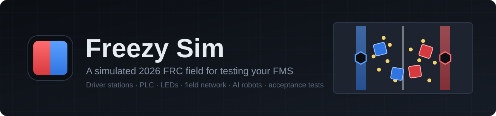
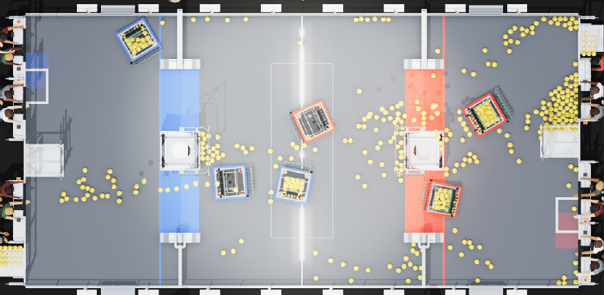
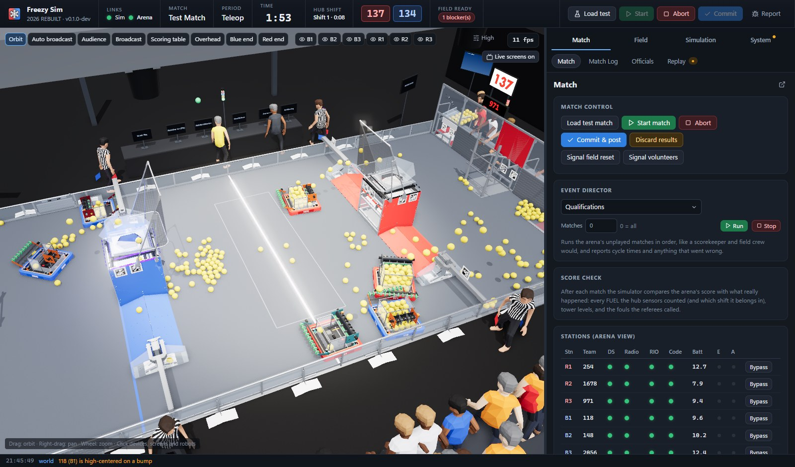
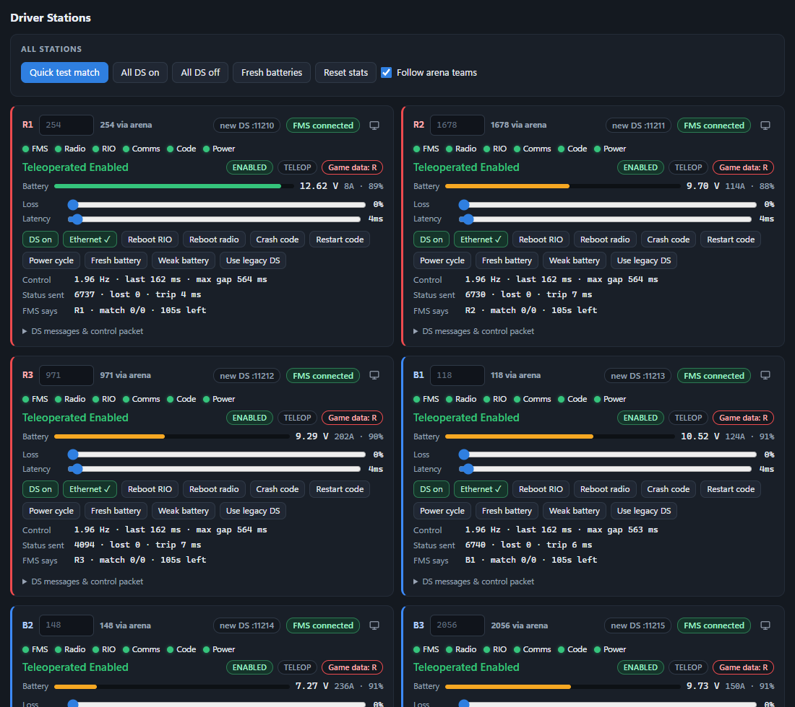
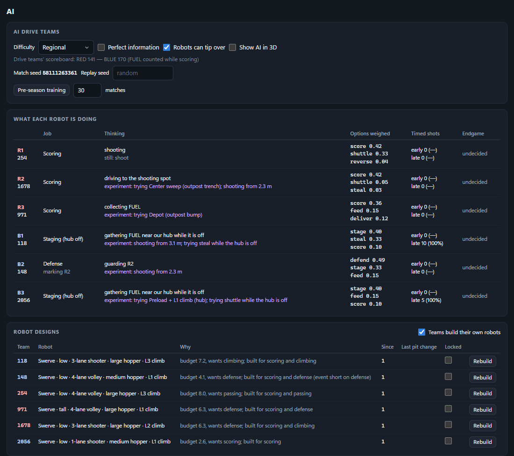
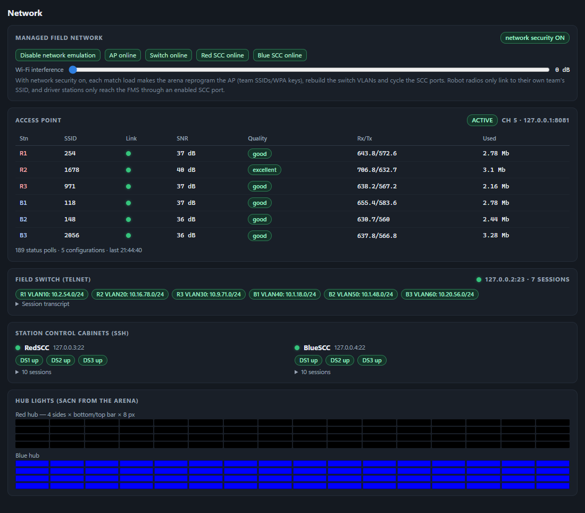
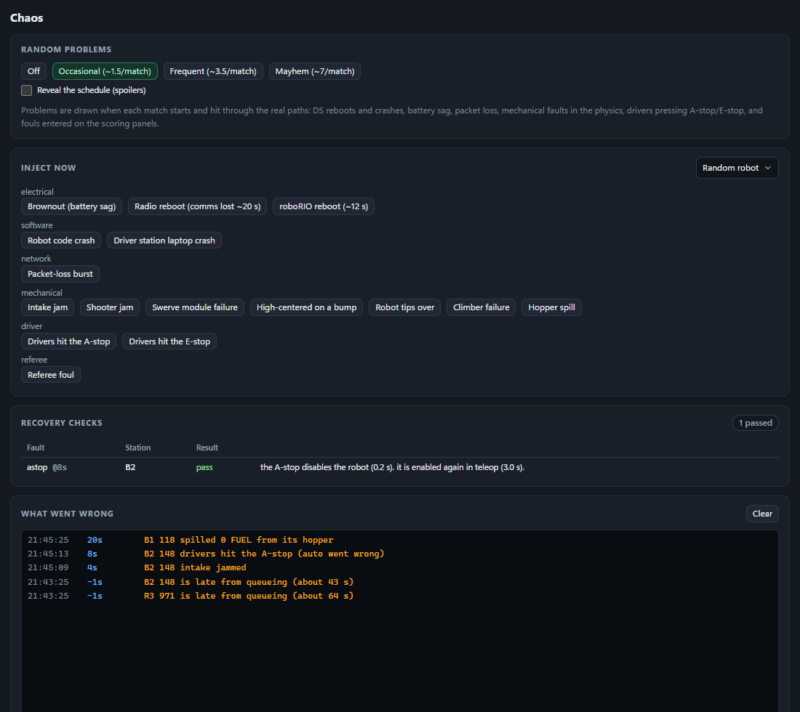
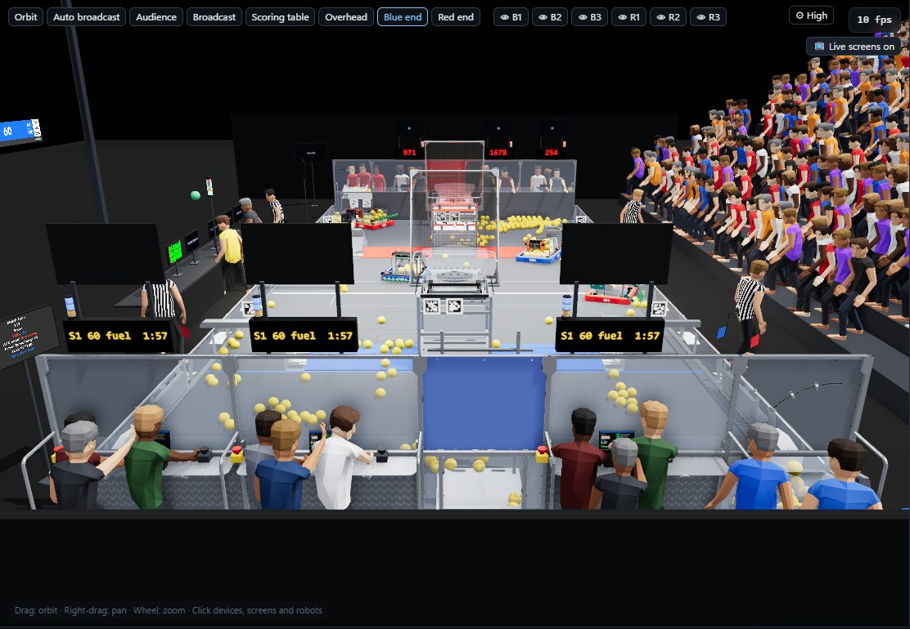
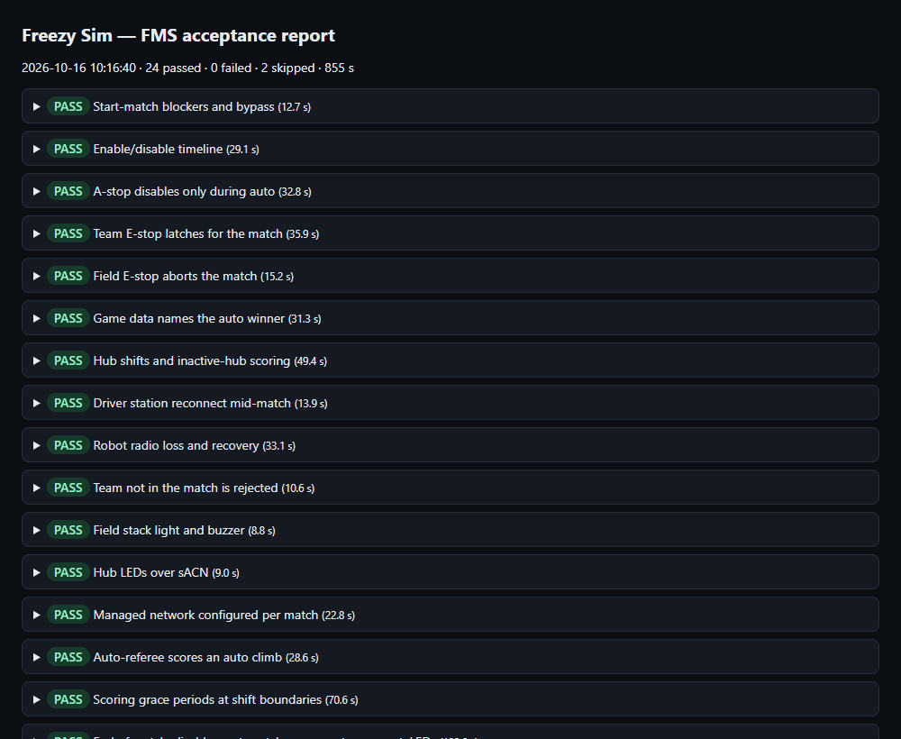

<p align="center">
  
</p>

<p align="center">
  <a href="https://github.com/Agame7k/freezy-sim/actions/workflows/test.yml"></a>
  <a href="https://github.com/Agame7k/freezy-sim/actions/workflows/dependabot/update-graph"></a>
  <a href="https://github.com/Agame7k/freezy-sim/releases"></a>
  <a href="LICENSE"></a>
  
  
  
</p>

<p align="center">
  <b>Test your field management system against a whole simulated event: no field, no robots, no volunteers.</b>
  <br>
  <a href="docs/GETTING_STARTED.md">Getting started</a> ·
  <a href="docs/USER_GUIDE.md">User guide</a> ·
  <a href="docs/TESTING.md">Testing an arena</a> ·
  <a href="docs/README.md">All docs</a>
</p>

Freezy Sim stands in for everything a field management system talks to at an event: six driver stations, the field PLC
or E-stop boxes, the hub LEDs, the access point, the field switch and both SCCs. It plays real 2026 REBUILT matches
against your arena in a 3D venue, with AI robots, referees, an FTA and a field crew.

It was built for [Freezy Arena](https://github.com/Freezy-Arena/freezy-arena) and works with
[Cheesy Arena](https://github.com/Team254/cheesy-arena) and other forks of it. It talks to the arena **only over the
wire**, the same way real hardware does, so whatever it finds is real arena behavior.

It also runs **headless as an acceptance-test rig**: an automated FMS test suite, soak tests, a whole unattended mock
event, and side-by-side comparisons of two arena versions, all with HTML and JUnit reports.

<p align="center">
  
  <br>
  <sub>A real match against the arena: six AI robots collecting, shooting and scoring FUEL (field shown with FIRST's
  official CAD, which you import yourself).</sub>
</p>

> Freezy Sim is an independent project. It is not made, sponsored or endorsed by *FIRST*® or Team 254. See
> [Trademarks](#license-and-trademarks).

## A look around



<table>
  <tr>
    <td width="50%"><br><sub><b>Driver stations.</b> Six simulated DSs, each with a robot you can brown out, reboot or unplug.</sub></td>
    <td width="50%"><br><sub><b>AI drive teams.</b> What each robot is thinking, the robots teams built, and their autos.</sub></td>
  </tr>
  <tr>
    <td><br><sub><b>The field network.</b> AP SSIDs, switch VLANs, SCC ports and the hub LEDs, live from the arena.</sub></td>
    <td><br><sub><b>Chaos.</b> Inject faults, and check that the arena noticed and recovered.</sub></td>
  </tr>
  <tr>
    <td><br><sub><b>The venue.</b> Drive teams, referees, the FTA, field crew and a crowd.</sub></td>
    <td><br><sub><b>Acceptance reports.</b> 23 FMS tests with HTML and JUnit output.</sub></td>
  </tr>
</table>

## Features

- **Real field hardware, emulated.** Both driver station protocols, a Modbus-TCP PLC (or Freezy's ESP32 E-stop
  boxes), sACN hub LEDs, a Vivid-style AP, a Cisco-style switch and two SCCs over SSH. The arena configures and talks
  to them exactly as it would at an event.
- **A full 3D venue.** The 2026 field (or FIRST's official CAD, if you import it), live hub LEDs and stack lights from
  the arena's own packets, every arena display on screens around the venue, and an AI broadcast camera director.
- **A spectator view.** Viewer mode shows just the match: the broadcast camera with the arena's own audience overlay
  keyed over it, as a stream would show it. Give spectators the `?view=viewer` link.
- **Matches that play themselves.** Swerve robots with real motor curves, FUEL physics and hub flow, team-built robot
  designs, autonomous routines, AI strategy that learns across an event, human players, a head referee who calls
  fouls, an FTA, and a field crew who reset the field between matches.
- **Things going wrong, on purpose.** Brownouts, radio drops, code crashes, E-stops, no-shows and late teams, each
  followed by a check that the arena handled it.
- **Automated testing.** 23 built-in acceptance tests, your own tests written in JSON, soak runs, regression comparisons
  across arena commits, and bug-report bundles with a replayable black box.
- **A whole mock event.** Quals, scouting, alliance selection and a double-elimination playoff, run unattended.
- **Drive it yourself.** Take over any robot with the keyboard or a gamepad.

## What it emulates

| Device | Protocol | Where the sim listens (default) |
|---|---|---|
| 6 driver stations (new and legacy DS) | TCP 1750 and UDP 1160 to the arena; FMS control packets back | UDP 11210–11215 (legacy DS: 1121) |
| Field PLC (`plc` profile) | Modbus TCP | `127.0.0.1:502` |
| ESP32 E-stop boxes (`altio` profile, Freezy Arena) | HTTP health probe, POSTs to the arena | `127.0.0.5–7:80` |
| Hub LEDs | sACN / E1.31 (DMX over UDP) | `127.0.0.1:5568` |
| Access point | HTTP JSON API | `127.0.0.1:8081` |
| Field switch | telnet CLI | `127.0.0.2:23` |
| Red and blue SCCs | SSH | `127.0.0.3:22`, `127.0.0.4:22` |

Everything binds to loopback addresses, so nothing reaches your network. Details: [docs/PROTOCOLS.md](docs/PROTOCOLS.md).

## What you need

| | Why | Get it |
|---|---|---|
| **Windows 10 or 11** (64-bit) | The GUI is a native Windows window. Headless modes compile for Linux and macOS but are untested there | — |
| **Microsoft Edge WebView2 Runtime** | Draws the GUI. Already installed on Windows 11 and on up-to-date Windows 10 | [developer.microsoft.com/microsoft-edge/webview2](https://developer.microsoft.com/en-us/microsoft-edge/webview2/) ("Evergreen Bootstrapper") |
| **An arena checkout** | The FMS being tested | [Freezy Arena](https://github.com/Freezy-Arena/freezy-arena) or [Cheesy Arena](https://github.com/Team254/cheesy-arena) |
| **Go 1.27 or newer** | Builds the arena from source in a sandbox, and the sim if you build it yourself | [go.dev/dl](https://go.dev/dl/) |
| Git *(optional)* | Cloning the repos; needed for `-compare` and `-arena-ref` | [git-scm.com/downloads/win](https://git-scm.com/downloads/win) |
| FreeCAD 1.1 *(optional)* | Converting FIRST's official field CAD for the 3D view | [freecad.org/downloads.php](https://www.freecad.org/downloads.php) |
| FIRST's 2026 field STEP *(optional)* | The official field model you convert with FreeCAD | [FIRST playing field page](https://www.firstinspires.org/resources/library/frc/playing-field) ("Official Field Assets", STEP File) |
| Tailscale *(optional)* | Opening the sim from another device | [tailscale.com/download](https://tailscale.com/download) |
| A gamepad *(optional)* | Driving a robot yourself (any Xbox-style controller) | — |

## Quick start

**1. Get the sim.** Download `freezy-sim-v0.1.0-windows-amd64.zip` from the
[Releases page](https://github.com/Agame7k/freezy-sim/releases) and unzip it anywhere. Or build it from source:

```bash
git clone https://github.com/Agame7k/freezy-sim.git
```

```bash
cd freezy-sim
```

Then run `build.cmd` (or double-click it). Plain `go build` in the root folder fails with "no Go files", because the
program is in `cmd/freezy-sim`. `build.cmd` runs `go build -o freezy-sim.exe ./cmd/freezy-sim` for you, and first
moves a running `freezy-sim.exe` aside so the build is not blocked.

**2. Get an arena.** Clone the arena somewhere else (the sim only ever reads this folder):

```bash
git clone https://github.com/Freezy-Arena/freezy-arena.git
```

**3. Point the sim at it.** Usually automatic: on the first run the sim looks for the arena next to its own folder and
in your home, Documents, Desktop, Downloads and OneDrive folders. If it can't tell which one you mean, a banner asks you
to choose the folder (the one with `go.mod` in it). To set it by hand, copy `config.example.json` to `freezy-sim.json`
in the sim folder and set `arena.sourceDir`:

```json
{ "arena": { "sourceDir": "C:/path/to/freezy-arena" } }
```

For Cheesy Arena, also set `"field": { "profile": "plc" }` (see [Compatibility](#compatibility)).

**4. Run `freezy-sim.exe`.** The sim builds the arena into a sandbox under `run/arena/`, starts it there, configures
it for the simulated hardware and opens the main window. Press **Load test**, then **Start**, to play a match.

The step-by-step version, with what you should see at each step, is in
[docs/GETTING_STARTED.md](docs/GETTING_STARTED.md).

## Headless modes

| Command | What it does |
|---|---|
| `freezy-sim -suite acceptance` | Runs the FMS acceptance suite against the sandbox arena. Writes `run/reports/acceptance-*.html` and a JUnit `.xml`; exits 1 on any failure |
| `freezy-sim -suite acceptance -tests grace,leds-shifts` | Runs only the listed tests |
| `freezy-sim -compare v1.4,HEAD,worktree` | Runs the suite against each arena version (git refs of the arena folder; `worktree` is the folder as it is). Exits 1 if a test that passed on the first ref fails on a later one |
| `freezy-sim -arena-ref <ref>` | Runs anything (GUI, suite, soak) against that arena commit |
| `freezy-sim -director event` | Runs a whole mock event unattended: remaining quals, scouting, alliance selection, playoffs. Exits 1 on any anomaly |
| `freezy-sim -soak 20 -soak-chaos 2` | Plays 20 AI matches back to back with injected faults, checking stability and the arena's score after each |
| `freezy-sim -suite ai -bench-matches 50` | Offline AI benchmark (no arena; much faster than real time) |
| `freezy-sim -version` | Prints the version and exits |

Every flag is in [docs/CLI.md](docs/CLI.md). Running the suite in CI is covered in [docs/TESTING.md](docs/TESTING.md).

Whenever a headless run finds a problem, it saves a **bug-report bundle** (`run/reports/bundle-*.zip`) with a
replayable black-box recording, the match seed, every live state value, the sim's and arena's logs, the arena's
database and the config (passwords removed). The 🐞 button in the GUI saves one on demand.

## Compatibility

| Arena | Status |
|---|---|
| Freezy Arena (2026) | What the sim is developed and tested against. Every feature works |
| Cheesy Arena (2026 game) | Expected to work with `field.profile` set to `"plc"`. Not tested by the project yet; reports welcome |
| Other forks of Cheesy Arena | Should work if they keep Cheesy Arena's driver station, PLC and network protocols |

Three features are Freezy-only, and other arenas simply don't use them: the ESP32 E-stop boxes (`altio` profile), team
stack lights in the 3D view, and the PLC winner light show. On other arenas, the `estopbox` test skips itself (it only
runs on the `altio` profile), and `winnerlights` is expected to fail, because it checks Freezy Arena's winner coils.
Details: [docs/PROTOCOLS.md](docs/PROTOCOLS.md#arena-compatibility).

## Documentation

| Guide | What's in it |
|---|---|
| [Getting started](docs/GETTING_STARTED.md) | Install, first run, first match, what to do when something is missing |
| [User guide](docs/USER_GUIDE.md) | The main window, every panel, driving a robot, the event director |
| [Configuration](docs/CONFIGURATION.md) | Every key in `freezy-sim.json`, with example setups |
| [Command line](docs/CLI.md) | Every flag, exit codes, and the files each mode writes |
| [Testing](docs/TESTING.md) | The acceptance suite, soak tests, comparing arena versions, bug bundles, CI |
| [Writing test scenarios](docs/SCENARIOS.md) | The JSON scenario format, step by step |
| [Protocols and ports](docs/PROTOCOLS.md) | What each emulated device speaks, ports, firewall, arena compatibility |
| [The simulation](docs/SIMULATION.md) | Physics, robots, AI, officials and determinism |
| [Recordings and replay](docs/RECORDINGS.md) | Match recordings, the black box, and bundle contents |
| [Official field model](docs/FIELD_MODEL.md) | Converting FIRST's field CAD with FreeCAD and importing it |
| [Troubleshooting](docs/TROUBLESHOOTING.md) | Symptoms and fixes, and an FAQ |
| [Architecture](docs/ARCHITECTURE.md) | How the code is organized |
| [Development](docs/DEVELOPMENT.md) | Building, testing and changing the sim |

## Contributing

Bug reports, test scenarios and fixes are welcome. Start with [CONTRIBUTING.md](CONTRIBUTING.md). Please attach a
bug-report bundle to bug reports; it usually has everything needed to reproduce the problem. Security issues: see
[SECURITY.md](SECURITY.md).

## License and trademarks

Freezy Sim is released under the [MIT License](LICENSE). It bundles three.js, the Quaternius "Animated Human" model
and a few Go libraries, each under its own permissive license: see [THIRD_PARTY_NOTICES.md](THIRD_PARTY_NOTICES.md).

FIRST's official field CAD is **not** included. FIRST publishes it for teams but doesn't license it for
redistribution, so each user downloads and converts their own copy ([docs/FIELD_MODEL.md](docs/FIELD_MODEL.md)). The
arena is never included either: the sim builds your own checkout in a local sandbox.

*FIRST*®, *FIRST*® Robotics Competition and FRC® are registered trademarks of *FIRST*® (For Inspiration and Recognition
of Science and Technology). REBUILT and FUEL are names from FIRST's 2026 game. Cheesy Arena is a project of Team 254.
Freezy Sim is not affiliated with or endorsed by any of them, or by any vendor named in it.

## Credits

- [Cheesy Arena](https://github.com/Team254/cheesy-arena) by Team 254, the FMS that Freezy Arena and this simulator's
  protocols are built around.
- [Freezy Arena](https://github.com/Freezy-Arena/freezy-arena).
- [three.js](https://threejs.org) for the 3D venue, and [Quaternius](https://quaternius.com) for the people in it.
