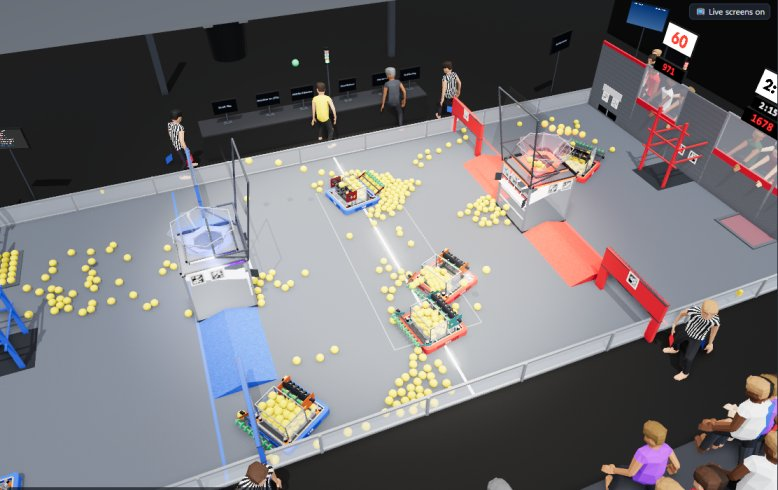
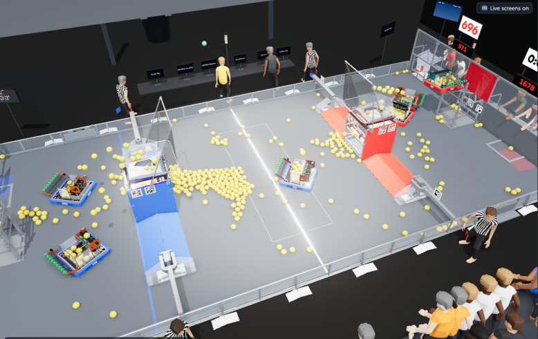
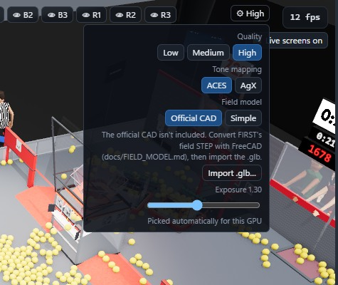

# The official field model

The 3D view can show FIRST's official 2026 REBUILT field CAD instead of the sim's own simpler field: every panel,
bracket, net and ramp, about a million triangles. Freezy Sim doesn't ship this model. You convert your own copy once,
with FreeCAD, and import it. The conversion runs unattended; the STEP import alone takes a few minutes.

Without it, the sim uses its built field. That one is fine for testing: the physics, the live parts (hub LEDs, chute
doors, signs, buttons, screens) and every test are the same either way. The official model only changes how the field
looks.

| Built field (included) | Official CAD (imported) |
|---|---|
|  |  |

> **Why it isn't included.** FIRST publishes the field CAD for teams, but its terms don't allow redistributing it. So
> each user downloads it from FIRST and converts it locally. Please don't share your converted `field-cad.glb`
> publicly unless FIRST has said you may.

## What you need

| | Get it |
|---|---|
| FreeCAD 1.1 (the installer or the portable zip) | [freecad.org/downloads.php](https://www.freecad.org/downloads.php) |
| FIRST's 2026 field STEP file, `FE-2026-rev-rebuilt-playing-field.step` | [FIRST's playing field page](https://www.firstinspires.org/resources/library/frc/playing-field), under "Official Field Assets": right-click **STEP File** and choose "Save link as…" |
| The converter script | `tools/cad/export_field.py`, in the sim's source and in the release zip |

**Keep the paths short.** FreeCAD fails on paths longer than 260 characters, and the STEP file has deeply nested part
names. Put FreeCAD, the STEP file and the output in short folders such as `C:\fc`. A FreeCAD inside a deeply nested
folder will fail.

## Convert it

1. Make a work folder and an output folder:

   ```bash
   mkdir C:\fc\out
   ```

2. Save the STEP file as `C:\fc\FE-2026-rev-rebuilt-playing-field.step`.

3. Open a **Command Prompt** (cmd.exe, not PowerShell) and set where the input and output are:

   ```bash
   set FIELD_STEP=C:\fc\FE-2026-rev-rebuilt-playing-field.step
   ```

   ```bash
   set OUT_DIR=C:\fc\out
   ```

4. Run the script with FreeCAD's command-line interpreter, `freecadcmd.exe`. It is in the `bin` folder of your
   FreeCAD install: `C:\Program Files\FreeCAD 1.1\bin` for the installer, or the unzipped folder's `bin` for the
   portable version. Change the two paths to match yours:

   ```bash
   "C:\Program Files\FreeCAD 1.1\bin\freecadcmd.exe" -c "exec(open(r'C:\freezy-sim\tools\cad\export_field.py').read())"
   ```

   The first run imports the STEP file, which takes a few minutes and is saved as `field.FCStd` so later runs skip
   it. The script then meshes every part and writes:

   | File in `OUT_DIR` | |
   |---|---|
   | `field-cad.glb` | **The model to import**, about 14 MB |
   | `export.txt` | The log: parts per element, triangle counts, time taken |
   | `bump-profile.json` | The BUMP's measured cross-section (the sim already has these numbers built in) |
   | `field.FCStd` | FreeCAD's copy of the imported STEP, kept to speed up the next run |

The script leaves out fasteners, tape, cable ties, FUEL, carpet, the scoring table and the AprilTags, because the view
draws its own of each. It merges the rest into one mesh per field element, material and alliance, in meters, with the
field center at the origin.

## Import it

In the sim:

1. Click **⚙** at the top right of the 3D view.
2. Under **Field model**, click **Import .glb…** and pick `C:\fc\out\field-cad.glb`.
3. It switches to **Official CAD** as soon as the import finishes.

<p align="center"></p>

Or copy the file to `run\models\field-cad.glb` in the sim folder yourself. Then switch **Field model** to **Simple** and
back to **Official CAD**, or restart the sim. No rebuild is needed.

The same menu shows the imported model's size, and has **Replace .glb…** and **Remove**. Deleting the `run` folder also
removes it.

The official model is the default on the Medium and High graphics presets. On Low, or with **Field model → Simple**,
the view uses the lighter built field.

## Troubleshooting

| Problem | Fix |
|---|---|
| FreeCAD fails with a path or file-name error | A path is too long. Move FreeCAD, the STEP file and `OUT_DIR` to a short folder like `C:\fc` |
| `KeyError: 'FIELD_STEP'` | The `set FIELD_STEP=...` line wasn't run in the same Command Prompt window |
| "that is not a binary glTF 2.0 (.glb) file" on import | You picked a different file. Import `field-cad.glb` from `OUT_DIR` |
| "the .glb file is incomplete" | The export didn't finish. Check `export.txt`, then run the script again |
| The view stays on the simple field | Check that **Field model** is set to **Official CAD** and the graphics preset isn't Low. Then look for an error in the console: run the sim with `-debug` and press F12 |
| The view is slow with the official model | Pick the Medium preset or the simple field. The model is about a million triangles |

The script was written for FreeCAD 1.1 and the 2026 REBUILT STEP release. A later revision of the STEP file can rename
parts. If elements come out missing or the wrong color, the name patterns at the top of `export_field.py` are where to
look.
