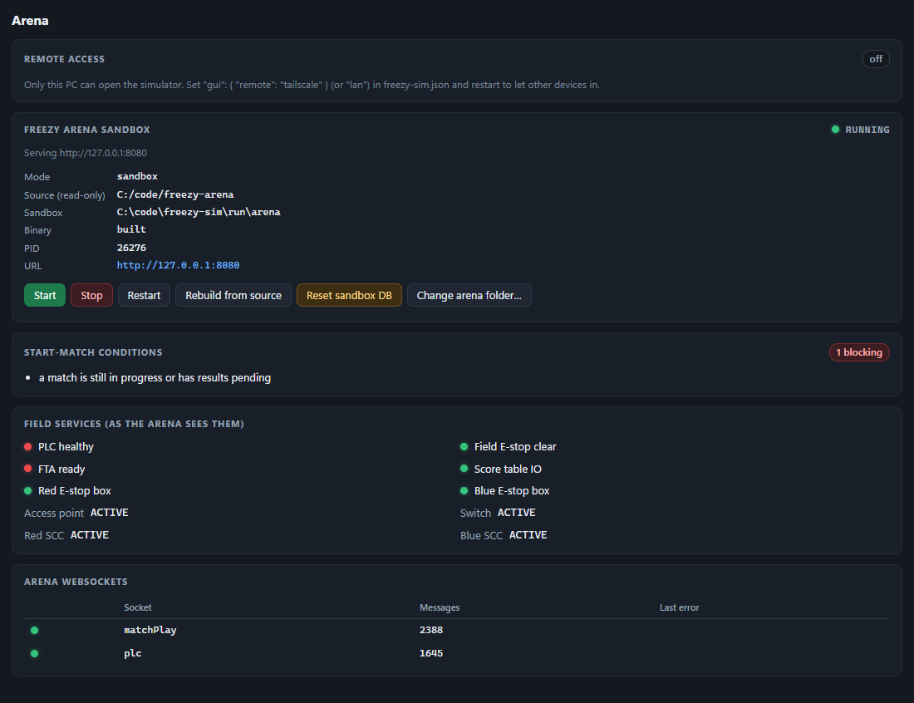

# Getting started

This walks you from nothing to a match playing on a simulated field. It takes about 15 minutes, most of it downloads.

## 1. Install what you need

| | Why | Get it | Check it |
|---|---|---|---|
| **Windows 10 or 11** (64-bit) | The GUI is a native Windows window | — | — |
| **WebView2 Runtime** | Draws the GUI. Already on Windows 11 and on up-to-date Windows 10 | [Microsoft's WebView2 page](https://developer.microsoft.com/en-us/microsoft-edge/webview2/): download the "Evergreen Bootstrapper" | *Settings → Apps* lists "Microsoft Edge WebView2 Runtime" |
| **Go 1.27+** | The sim builds the arena from source. You also need it to build the sim yourself | [go.dev/dl](https://go.dev/dl/): the Windows `.msi` installer | `go version` in a new terminal |
| **Git** | Downloading the arena (and the sim, from source) | [git-scm.com/downloads/win](https://git-scm.com/downloads/win) | `git --version` |
| **An arena** | The FMS under test | [Freezy Arena](https://github.com/Freezy-Arena/freezy-arena) or [Cheesy Arena](https://github.com/Team254/cheesy-arena) | — |

These are optional and can be added later:

| | Why | Get it |
|---|---|---|
| FreeCAD 1.1 | Converting FIRST's official field CAD for the 3D view ([FIELD_MODEL.md](FIELD_MODEL.md)) | [freecad.org/downloads.php](https://www.freecad.org/downloads.php) |
| FIRST's 2026 field STEP | The official field model itself | [FIRST playing field page](https://www.firstinspires.org/resources/library/frc/playing-field): "Official Field Assets", STEP File |
| Tailscale | Opening the sim from a laptop, tablet or phone ([CONFIGURATION.md](CONFIGURATION.md#remote-access)) | [tailscale.com/download](https://tailscale.com/download) |
| A gamepad | Driving a robot yourself. Any Xbox-style controller works | — |

> Why Go, even with the prebuilt download? The sim never runs your arena folder directly. It builds a private copy
> into a sandbox, so your folder and its `event.db` are never touched. If your arena folder already has a prebuilt
> `cheesy-arena.exe`, you can skip Go and set `arena.preferBuild` to `false`.

## 2. Get the sim

**Option A, the release zip.** Download `freezy-sim-v0.1.0-windows-amd64.zip` from the
[Releases page](https://github.com/Agame7k/freezy-sim/releases). Optionally check it against the `.sha256` file
published beside it:

```bash
certutil -hashfile freezy-sim-v0.1.0-windows-amd64.zip SHA256
```

Unzip it somewhere you can write to. It unpacks into a `freezy-sim-v0.1.0-windows-amd64` folder, which you can rename
or move, for example to `C:\freezy-sim`. Avoid `C:\Program Files`, because the sim writes its sandbox, logs and
reports next to the exe.

The exe isn't code-signed, so the first time you run it Windows SmartScreen may say "Windows protected your PC". Choose
**More info → Run anyway**.

**Option B, from source.**

```bash
git clone https://github.com/Agame7k/freezy-sim.git
```

```bash
cd freezy-sim
```

```bash
build.cmd
```

`build.cmd` builds `freezy-sim.exe` in the folder. You can also double-click it.

## 3. Get an arena

Clone it into its own folder, next to the sim rather than inside it:

```bash
git clone https://github.com/Freezy-Arena/freezy-arena.git
```

Or use Cheesy Arena:

```bash
git clone https://github.com/Team254/cheesy-arena.git
```

You don't need to build or run the arena yourself. The sim does that.

## 4. Configure

**Usually there is nothing to do.** On the first run the sim looks for an arena folder in the usual places: next to
the sim folder, and in your home, Documents, Desktop, Downloads, `source`, `code`, GitHub and OneDrive folders. If it
finds exactly one, it uses it and saves it to `freezy-sim.json`. If it finds none, or several, a red banner at the top
says so; press **Choose arena folder** and either pick one it found, browse for it, or paste the path. Pick the folder
with `go.mod` in it. If you pick the folder around it (where a zip was extracted, say), the sim tells you which folder
inside to pick instead. You can change it later with **Change arena folder…** in the **Arena** panel.

To set it by hand instead, copy `config.example.json` to `freezy-sim.json` in the sim folder and set
`arena.sourceDir` to the arena folder. Use forward slashes, or double the backslashes:

```json
{
  "arena": { "sourceDir": "C:/code/freezy-arena" }
}
```

For **Cheesy Arena**, also choose the PLC field profile, since the default (`altio`) uses Freezy Arena's E-stop boxes:

```json
{
  "arena": { "sourceDir": "C:/code/cheesy-arena" },
  "field": { "profile": "plc" }
}
```

A config only needs the keys you change. Everything else is in [CONFIGURATION.md](CONFIGURATION.md).

## 5. First run

Double-click `freezy-sim.exe`, or run it from a terminal to watch the log. This is what happens:

1. A console window opens with the log. It is also saved to `run/logs/`.
2. The sim checks the ports its emulated devices need. Any conflict is reported once, with what to do about it.
3. It builds the arena into `run/arena/` and copies the arena's `static/`, `templates/`, `schedules/` and `font/`
   folders beside it. The first build takes a minute or two; after that only changes are rebuilt.
4. It starts the arena there with `-dev`. **Windows Firewall may ask about `cheesy-arena.exe`.** Allowing private
   networks is enough. Answer the prompt for `freezy-sim.exe` the same way if you want other devices to reach the GUI.
5. On first connect, it configures the arena for the simulated hardware: PLC or E-stop box addresses, the sACN target,
   the AP, switch and SCC addresses, and TBA publishing off, so simulated results never reach The Blue Alliance.
6. The main window opens on the 3D venue.

The **Arena** panel shows each of these steps. If one fails, a red banner at the top of the window says what went
wrong, with a button that takes you to the fix. The Arena panel has the details, and
[TROUBLESHOOTING.md](TROUBLESHOOTING.md) has the fixes.



## 6. Play a match

1. Press **Load test** in the top bar. The arena loads a test match, the six driver stations connect, and the robots
   are carted onto the field.
2. Wait for **Field Ready** to turn green. Hover over it to see what the arena is still waiting for.
3. Press **Start**. Watch auto, the hub shifts, teleop and the endgame. The referees score the climbs, and the hub
   LEDs come from the arena's real sACN packets.
4. After the match, the sim checks the arena's score against what really happened on the field (the **score check** in
   the Match panel).
5. Press **Commit** to commit the result. The field crew then reset the field for the next match.

To drive a robot yourself, open the **Robots** panel and take control of one ([USER_GUIDE.md](USER_GUIDE.md#driving-a-robot)).


## 7. Run the tests

Close the window, then run the acceptance suite from a terminal in the sim folder:

```bash
freezy-sim.exe -suite acceptance
```

It plays the tests against the sandbox arena in real time (about 15 minutes for the whole suite), then writes
`run/reports/acceptance-<time>.html` and a JUnit `.xml`. It exits with code 1 if anything failed.


[TESTING.md](TESTING.md) covers the rest: running only some tests, soak tests, comparing arena versions, and CI.

## Where things are kept

Everything the sim writes goes under `run/` in the sim folder. Deleting `run/` resets the sim (it also removes an
imported field model and the AI's saved team memory).

| Path | What |
|---|---|
| `run/arena/` | The sandboxed arena: its exe, `event.db`, match logs and database backups |
| `run/arena-src/` | Arena versions exported for `-compare` and `-arena-ref` |
| `run/logs/` | The sim's daily log files (kept for two weeks) and crash stacks |
| `run/reports/` | Test, soak, event, benchmark and scouting reports, and bug-report bundles |
| `run/recordings/` | Match recordings (`.fsr`) for the Replay panel |
| `run/models/` | The imported official field model, if any |
| `run/state.json` | What the AI teams remember between sessions: robot designs, autos, learning |

Two things live outside the sim folder: the native window's browser profile in `%LOCALAPPDATA%\freezy-sim\webview2`,
and the window positions saved beside it. To uninstall, delete the sim folder and `%LOCALAPPDATA%\freezy-sim`.

## Next steps

- [USER_GUIDE.md](USER_GUIDE.md): every panel, and the event director
- [FIELD_MODEL.md](FIELD_MODEL.md): the official field CAD in the 3D view
- [SCENARIOS.md](SCENARIOS.md): write your own tests in JSON
