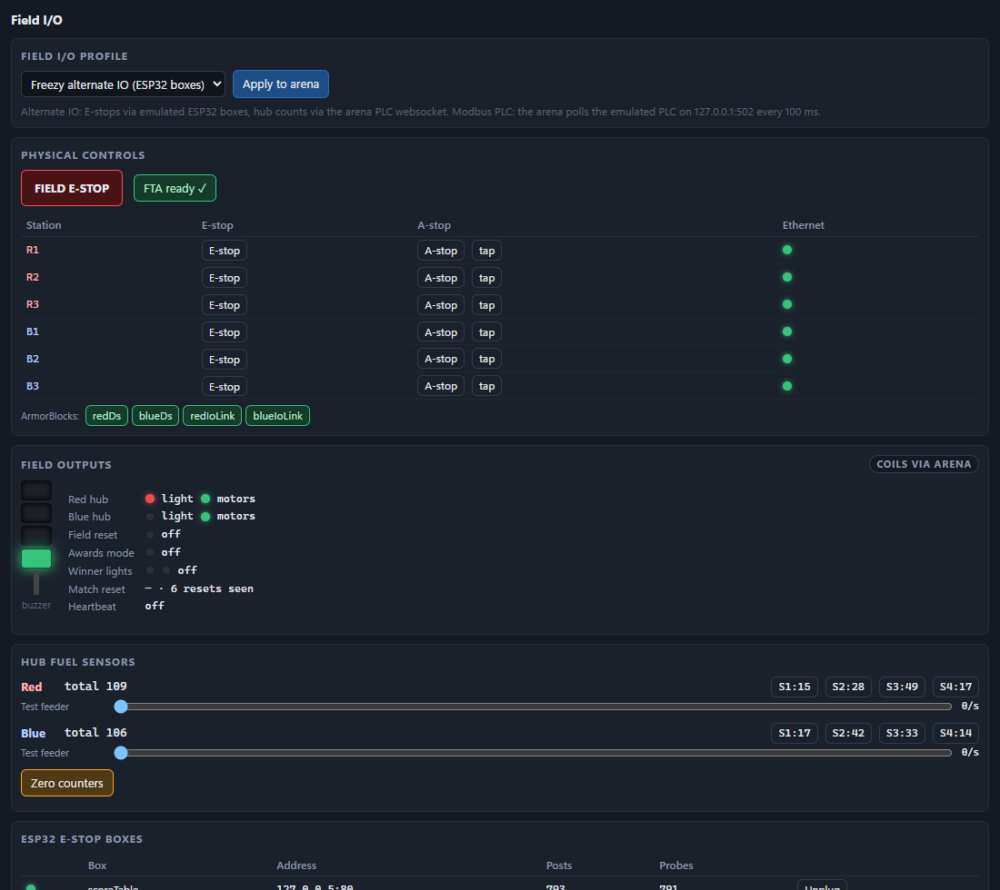
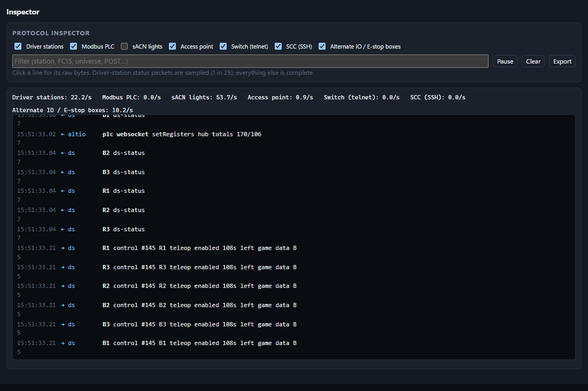

# Protocols and ports

Freezy Sim talks to the arena only over the wire, using the same protocols as real field hardware. Nothing is linked
into the arena or patched in it. This page lists what each emulated device speaks, where it listens, and how the sim
drives the arena itself.

```text
                         ┌───────────────────────────── Freezy Sim ─────────────────────────────┐
  arena  ── TCP 1750 ──▶ │ 6 driver stations (new + legacy DS)  ◀── UDP control ── arena        │
         ◀── UDP 1160 ── │                                                                      │
         ── Modbus 502 ─▶│ field PLC (plc profile)                                              │
         ◀─ HTTP POST ── │ 3 ESP32 E-stop boxes (altio profile) + PLC websocket                 │
         ── sACN 5568 ──▶│ hub LED receiver                                                     │
         ── HTTP ───────▶│ access point          ── telnet 23 ─▶ field switch                   │
         ── SSH 22 ─────▶│ red / blue SCC        (arena is the client for all three)            │
         ◀─ HTTP + WS ── │ arena client: match control, scoring panels, referee, setup pages   │
                         └──────────────────────────────────────────────────────────────────────┘
```

Every emulator binds to a loopback address, so nothing is exposed on your network. Windows answers on all of
`127.0.0.0/8` without any setup, which is why the devices can each have their own address (127.0.0.2, .3 and so on) and
use the standard ports without colliding with each other.

## Ports at a glance

| Device | Sim listens on | Arena connects to | Profile |
|---|---|---|---|
| Driver stations | UDP 11210–11215 (legacy DS: 1121) | It listens on TCP 1750 and UDP 1160 | all |
| Field PLC | TCP `127.0.0.1:502` | `plcAddress` setting, port 502 | `plc` |
| ESP32 E-stop boxes | TCP `127.0.0.5–7:80` (health probe) | The boxes POST to the arena | `altio` |
| Hub LEDs | UDP `127.0.0.1:5568` | Its sACN target, port 5568 | all |
| Access point | TCP `127.0.0.1:8081` | `apAddress` setting | network security on |
| Field switch | TCP `127.0.0.2:23` | `switchAddress` setting, port 23 | network security on |
| SCCs | TCP `127.0.0.3:22`, `127.0.0.4:22` | `redSCCAddress`, `blueSCCAddress`, port 22 | network security on |
| Simulator GUI | TCP `127.0.0.1:8090` | — | — |
| Sandbox arena | — | Its web server on TCP 8080, all interfaces in `-dev` mode | — |

All of these are configurable in [CONFIGURATION.md](CONFIGURATION.md). In sandbox mode the sim points the arena's
settings at them on first connect.

**Conflicts.** At startup, the sim tries every address before the emulators bind. If another program holds one (an
installed SSH server on port 22, a telnet service on 23, IIS on 80, another Modbus simulator), it reports which device,
which address and what to do. The usual culprit is a server listening on *all* addresses, which also covers the
loopback ones.

**Firewall.** The emulators are loopback-only, so the firewall never sees them. Windows may ask once about
`cheesy-arena.exe`, because the arena in `-dev` mode listens on all interfaces. It asks about `freezy-sim.exe` only if
you turn on [remote access](CONFIGURATION.md#remote-access).

## Driver stations

Six stations, R1–R3 and B1–B3, each with a simulated robot behind it: radio, roboRIO, user code and battery. The sim
implements both FMS protocols:

| | New DS | Legacy NI DS |
|---|---|---|
| Handshake (DS → FMS, TCP 1750) | Tag 30: UDP port, flags and the team as text | Tag 24: the team number |
| Station assignment (FMS → DS) | Tag 31 | Tag 25 |
| Control packets (FMS → DS, UDP) | To the port in the handshake (11210 + station) | To port 1121 (1120 for FMS Lite) |
| Game data | Tag 32 inside the UDP control packet | TCP tag 28 |
| Status (DS → FMS, UDP 1160) | Sequence, status byte (radio, roboRIO and robot links), team, battery, trip-time tags | Same |
| Keepalive and logs | TCP tag 29 keepalive; tag 22 DS log | Same |

Each station follows the match the arena loads, so it connects with that team, the way a real team would. You can break
any part of the chain from the **Driver Stations** panel: DS power, Ethernet, radio, roboRIO, code, packet loss,
latency, jitter, the battery, the protocol, or a wrong team. A full reboot takes a few seconds, shortened from real
hardware so tests stay quick. Battery voltage sags with the current the robot actually draws in the physics, so a
hard-pushing robot really browns out.


## Field PLC (Modbus TCP)

In the `plc` profile the sim is the field PLC, as on an official field. The arena polls it over Modbus TCP on port 502.
The sim supports read coils (0x01), read discrete inputs (0x02), read holding and input registers (0x03, 0x04), and
write single and multiple coils and registers (0x05, 0x06, 0x0F, 0x10).

| Inputs (read by the arena) | |
|---|---|
| 0 | Field E-stop |
| 1–12 | E-stop and A-stop for each station, in the order R1 E, R1 A, R2 E, R2 A, R3 E, R3 A, B1 E, B1 A, B2 E, B2 A, B3 E, B3 A |
| 13–18 | Ethernet link for R1–R3, then B1–B3 |
| 19 | FTA ready switch |
| 20–27 | Hub FUEL sensors: four red lanes, then four blue |

| Registers | |
|---|---|
| 0 | Field I/O connection status: the ArmorBlocks that are up |
| 1, 2 | Red and blue hub FUEL totals |
| 3–10 | Per-lane counts: four red lanes, then four blue |

| Coils (written by the arena) | |
|---|---|
| 0 | Heartbeat: the PLC watchdog. If it stops, the PLC reports the arena lost |
| 1 | Match reset |
| 2–6 | Field stack light: green, orange, red, blue, and the buzzer |
| 7, 8 | Field-reset and awards-mode lights |
| 9, 10 | Red and blue hub motors |
| 11, 12 | Red and blue hub lights |
| 13, 14 | Red wins and blue wins: pulsed when the result is shown, to start the winner light show (Freezy Arena) |

An arena that writes only the first 13 coils, like older versions, is accepted too. FUEL is counted by the hub's beam
breaks: every ball that physically passes a lane's exit gate in the simulation counts once, with the real sensor's
transit time. The arena reads the counts the same way it reads a real PLC.



## ESP32 E-stop boxes (Freezy Arena's alternate IO)

In the `altio` profile (the default), the field I/O works the way Freezy Arena's alternate-IO hardware does:

- **Three ESP32 E-stop boxes**: the scoring table (field E-stop), red and blue. Each answers the arena's TCP health
  probe on port 80 at its own address (127.0.0.5, .6, .7). On a press or release it POSTs its buttons' states to the
  arena's `/api/freezy/eStopState`.
- **The PLC websocket** (`/api/plc/websocket` on the arena) carries the rest: hub FUEL totals and lane counts, the
  Ethernet and FTA inputs, and the coils back to the field.

The Field I/O panel shows each box's link and every value it sends.

## Hub LEDs (sACN / E1.31)

The arena drives the hub light bars with E1.31 (sACN) DMX packets on UDP 5568. The sim receives them and decodes the
pixels with the same fixture map the arena uses, then paints the 3D hubs with them, so the venue shows exactly the
colors the arena sent. It tracks universes, sequence numbers and packet rate, which the `leds` and `leds-shifts` tests
check.

## Field network: AP, switch and SCCs

With `field.networkSecurity` on, the arena manages the field network itself, and the sim emulates each device it
manages:

- **Access point**: a Vivid-style AP with an HTTP API (`/status`, `/configuration`). The arena pushes the six team
  SSIDs and WPA keys at each match load and polls per-station status. The sim runs a simple RF model: each robot's
  signal quality and data rate depend on where it is relative to the AP above the scoring table.
- **Field switch**: a Cisco-style telnet CLI, close enough for the arena's configuration sessions. The arena sets one
  VLAN per team.
- **SCCs**: the two alliance station switches, reached over SSH. Ports 1/2–1/4 feed driver stations 1–3. The arena can
  shut a port down and bring it back.

These feed back into the driver stations. A robot's radio links only to an SSID the AP is broadcasting with the right
key, and a DS reaches the FMS only while its SCC port is up. A misconfigured network therefore shows up as robots that
don't connect, as it would at an event. The **Network** panel shows the live state, and the hub LEDs the sim receives
over sACN:


## Driving the arena

To run matches without a person at the scoring table, the sim also acts as the arena's operators, through the arena's
normal web interface:

| What | How |
|---|---|
| Watching the match | The match-play websocket: match state, timing, realtime score, station status, audience display |
| Loading, starting, aborting and committing matches | The same match-play websocket the scorekeeper's page uses |
| Scoring climbs and calling fouls (the AI referees) | The red and blue scoring panels and the head referee panel websockets |
| Configuring the arena for the sim | The settings page (`/setup/settings`) and the teams page (`/setup/teams`) |
| Alliance selection and playoffs | The alliance selection page, and the matches, rankings and alliances APIs |
| Logging in, when the arena has an admin password | `/login`, with `arena.adminPassword` |

The sim never edits the arena's database or files directly. In sandbox mode it uses its own private copy of the
arena, so your real event data is never touched.

## Arena compatibility

The protocols above are shared by Cheesy Arena and the forks of it, with a few exceptions:

| Feature | Freezy Arena | Cheesy Arena |
|---|---|---|
| Driver stations, Modbus PLC (`plc` profile), sACN, AP, switch, SCCs | ✓ | ✓, expected; not yet tested by the project |
| ESP32 E-stop boxes and the PLC websocket (`altio` profile) | ✓ | — (use `plc`) |
| Team stack lights in the 3D view (`/api/freezy/team_stack_light`) | ✓ | — (the 3D lights stay off; nothing else is affected) |
| Winner coils 13–14 and the winner light show | ✓ | — (the `winnerlights` test fails) |

The sim is built for the **2026 game** (REBUILT): FUEL, hubs, shifts and the tower. An arena for another season will
connect, but its matches won't make sense.

## Watching the traffic

The **Inspector** panel logs every packet and message the sim exchanges with the arena, for each protocol, with
filters and timing. It is the quickest way to see whether the arena sent something, and when.


