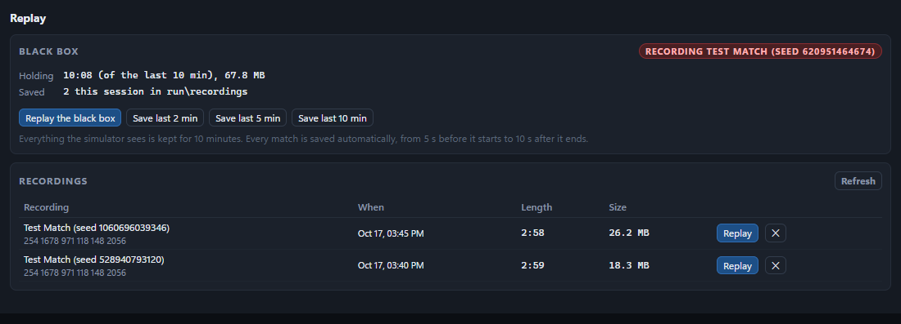

# Recordings, replay and bug bundles

The sim records everything it sees, so a problem can be watched again rather than described. Three things come from
that recorder:

| | What | Where |
|---|---|---|
| **Match recordings** | Every match, saved automatically, from 5 s before it starts to 10 s after it ends | `run/recordings/<time>_<match>-seed-<seed>.fsr` |
| **The black box** | A rolling buffer of the last 10 minutes, kept in memory | Replayed or saved (the last 2, 5 or 10 minutes) from the Replay panel, and included in every bug bundle |
| **Bug-report bundles** | A zip with everything needed to reproduce a problem | `run/reports/bundle-<time>.zip` |

## What is recorded

Each recording holds, on one timeline:

- the world, at 60 frames a second: every robot's pose and state, every FUEL, the hubs, the field crew
- every state topic on the simulator's bus: driver stations, field I/O, LEDs, the arena's status and score, the
  officials, the network
- the event log, from both the sim and the arena

## Watching a recording

Open the **Replay** panel and pick a match recording, or save and open the black box. While a replay plays, the
**whole GUI** shows the recorded moment, not just the 3D view: the panels, the top bar, the LEDs and the driver
stations. Use play/pause, ±5 s, the scrubber and the speed control. The panel lists the events on the timeline, so
you can jump straight to an E-stop or a fault. Press exit to go back to the live field.

To open a recording from a bug bundle, copy its `blackbox.fsr` into `run/recordings/` and pick it in the Replay panel.



## Bug-report bundles

The sim saves a bundle automatically when:

- an acceptance run has failures
- a soak match goes wrong
- the event director logs an anomaly

Automatic bundles are rate-limited to one every 2 minutes and at most 10 per run, so a run that keeps failing can't fill
the disk. You can also save one at any time with the 🐞 **Report** button in the top bar, which asks what went wrong.

| File in the zip | What it is |
|---|---|
| `manifest.json` | Why it was saved, the sim version, the match seed, the match state and teams, and a list of the files |
| `blackbox.fsr` | The last 3 minutes of the recorder, for the Replay panel |
| `topics.json` | Every live state value at the moment it was saved |
| `events.log` | The sim's and the arena's log lines |
| `arena/event.db` | The sandbox arena's database |
| `arena/...csv` | The arena's latest match logs |
| reports and logs | The latest test reports, and the sim's log files |
| `config.json` | The sim's config, with every password and token removed. Access tokens are also scrubbed from the logs |

**When you file an issue, attach the bundle.** It usually has everything needed to reproduce the problem. Check it
first if your event data is private: `arena/event.db` holds the sandbox arena's teams, schedule and results. That is
normally only test data, but an arena you seeded with a real event's teams will have them.

### Reproducing an AI match

The manifest has the match seed. Enter it in the **AI** panel before loading the next match, and the AI makes the same
decisions again ([SIMULATION.md](SIMULATION.md#time-and-determinism)).

## File format

`.fsr` files ("Freezy Sim Recording") are written by `internal/recorder`:

```text
"FSR1" | u32 meta length | meta JSON | gob-encoded chunks
```

- **Meta** is plain JSON at the front of the file (label, times, seed, teams), so the Replay panel can list recordings
  without reading them.
- **Chunks** each hold a run of entries, compressed with DEFLATE. An entry is a world snapshot (the same binary frame the
  3D view receives, documented in `internal/world/snapshot.go`), a topic value, or an event.
- **Every chunk starts with a keyframe** holding the value of every topic at that moment, so playback can start at any
  chunk without reading the ones before it.

The format is internal and may change between versions. A recording made by one version is not guaranteed to open in
another.
