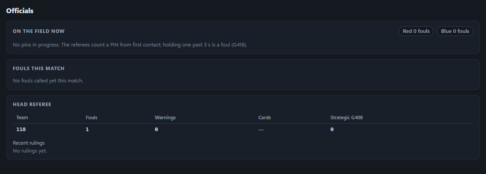

# The simulation

The sim plays real matches, so the arena gets the traffic it would get at an event: robots that link and drop,
FUEL that trips the hub sensors at believable rates, climbs for the referees to score, and fouls. This page explains
what is simulated and how far to trust it. The code is in `internal/world` (physics and AI), `internal/referee` and
`internal/fta` (officials).

The **world** is the single source of truth for what happened on the field. Everything the arena is told (sensor
counts, climbs, fouls) comes from it, and after each match the sim compares the arena's committed score with the
world's own record (the *arena-diff*). A mismatch is a real finding about the arena, not noise.

## The field

The field follows the 2026 REBUILT game manual and FIRST's field drawings. The layout, AprilTag poses, hubs, bumps,
trenches, towers, outposts and depots are in [`web/layouts/field-2026.json`](../web/layouts/field-2026.json), which is
shared by the physics and the 3D view. The bump profile was measured from FIRST's field CAD.

There are 504 FUEL. Each is a simulated foam ball with spin: shooters put backspin on it (Magnus lift), it checks up and
rolls on the carpet, and its bounce gets deader the harder it is hit. FUEL that leaves the field rolls on the venue
floor until the staff toss it back.

**The hubs** are physical. FUEL falls through a funnel and throat, down a ramp, into lanes separated by dividers, and out
through exit gates. Each lane's beam break sits at its exit gate, so every ball is counted exactly once, with the real
sensor's transit time, and only after it has been counted does it leave. Those counts are what the arena reads from the
PLC. The hub motors run when the arena turns them on.

## Robots

Every team builds its own robot from a kit of parts, within a budget and for the role it wants to play: a swerve base,
an over-the-bumper intake, a hopper, a shooter (fixed or turreted) and a climber. Teams change their designs in the pits
between matches. The AI panel's **Robot designs** card shows each design and lets you lock or rebuild one. In 3D each
robot is drawn from its own parts: pre-drilled tube, wiring from the battery and power distribution hub to the motors,
cloth bumpers with the team number printed on them, swerve modules that steer under a fixed housing, and a shooter
driven straight or by belt. Every model stays inside its frame and bumpers and under its height when stowed; an intake
wider than the frame slides out roller extensions as it deploys.

**Driving** uses a per-module swerve force model: motor curves, gearing, current limits, the battery's voltage, and
tread grip that depends on the weight on each wheel. Acceleration, top speed, wheel slip and pushing matches come out of
that, not from tuned speeds. The current drawn is fed to the battery model, so a robot that pushes hard really sags its
battery and can brown out.

**The chassis** rides on its wheels: over the bumps, possibly grounding its belly pan on a crest, and tipping over only
when its center of gravity really passes the edge of its wheelbase, including from a hit at bumper height. Tipping can
be turned off in the AI panel ("Robots can tip over"). A tipped robot is E-stopped by its drive team.

**Hoppers** simulate the FUEL inside them: balls settle, slosh and jam against the shooter. A hopper's capacity is
whatever fits, found by filling it in the simulation.

**Collisions** between robots, and with the walls, are impulse-based, with bumper and wall restitution and friction
tuned with the AI benchmark.

## The AI

Each robot is played by an AI drive team with its own personality and skill, and memory that carries across matches.

- **Autonomous.** Every team has a library of pre-programmed auto routines. They follow their paths blind, on
  odometry corrected by AprilTag vision, so a bump or a hit throws them off as it would a real robot. Teams pick an auto
  per match, sometimes pick the wrong one on the DS chooser, check for conflicts with their partners in queueing, and
  tune their autos between matches.
- **Teleop.** Robots collect FUEL, shoot (turrets lead their shots on the move), play defense, and avoid hazards. They
  follow the game's hub shifts from the game data the arena sends. Drive coaches call strategy, and three human players
  per alliance feed FUEL.
- **Endgame.** Robots climb the tower, with vision-assisted alignment.
- **Learning.** Each team keeps track of what worked (auto choice, shooting range, what to do while its hub is
  inactive, when to climb) and chooses with Thompson sampling, so strategies drift towards what pays off over an event.
- **Mistakes and reliability.** Drivers make natural mistakes, mechanisms fail and get repaired between matches, and a
  robot that breaks tries to recover. Practice and test matches are played looser, with less defense, more curiosity
  and quieter coaches.

What the teams remember (designs, autos, learning, reliability) is saved in `run/state.json` and survives restarts.
The AI panel can run **pre-season training** offline, to give teams a history before an event.

The **AI** panel shows what each robot is doing and why, the options it weighed, and the robot each team built:

## Officials

- **Referees.** A rules engine watches the world (contacts, zones, FUEL released by the hubs) and calls the game rules
  it covers: G403, G405, G407, G408, G418, G419 and G420. The line referees enter the fouls and the climbs through
  the arena's own scoring and referee panels, as people would.
- **Head referee.** Keeps the event-wide record a real head referee keeps: verbal warnings, and yellow cards that carry
  between matches. Decides the cards after each match, and runs the post-match field signals: purple when it is safe for
  field staff, then green when it is safe for everyone.
- **FTA.** Watches the arena the way an FTA watches the Field Monitor. Before each match it runs the connection checklist
  for every station and works problems with the teams, who then power-cycle a radio, restart code or swap a battery. If
  allowed, it bypasses a robot that can't be made ready in time. Only then does it report the field ready. During the
  match it logs link drops.
- **Field crew.** Between matches, the crew cart robots off and on through the gates, and a six-person crew restages
  the FUEL. The FTA holds the field until they are done.
- **Drive teams.** Press E-stops and A-stops, work on their laptops before the match, and swap and age batteries.

## Time and determinism

Matches against the arena run in real time, because the arena's match clock is wall time. The physics runs at a fixed
step and streams 60 snapshots a second to the 3D view.

Every match gets a **seed** when it is loaded. The seed fixes the AI's random choices, so you can replay a match's
decisions by entering its seed in the AI panel before loading the next match. The seed is saved in every recording and
bug bundle. Against a live arena, network and OS timing still differ slightly from run to run, so a replayed match
follows the same plan but is not identical frame for frame.

The **AI benchmark** (`-suite ai`) runs whole events inside the world with no arena and no wall clock. It is fully
deterministic: the same seed gives the same matches, which makes it the tool for measuring a change to the physics or
the AI. `-bench-save-baseline` keeps a run to compare later runs against.

## How far to trust it

The sim is built to exercise an FMS, not to predict real robot performance. In particular:

- Robot designs and the AI are plausible, not modeled on real teams. Team numbers are only labels.
- FUEL physics and robot dynamics are tuned to look and score believably. They are not validated against measured
  robots.
- The rules engine covers the rules listed above. Other fouls (and a referee's judgement calls) are not simulated,
  except as random fouls injected by the chaos tools.
- Field details that aren't in public documents are approximated in the layout file.

When a test fails, it is worth asking whether the arena or the sim is wrong. Bug bundles, recordings and the
arena-diff are there to help answer that ([RECORDINGS.md](RECORDINGS.md)).
