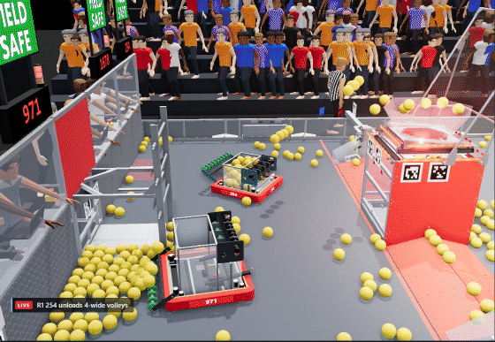
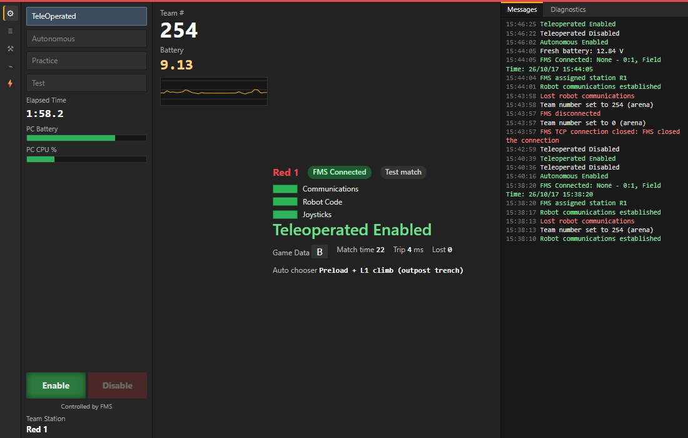
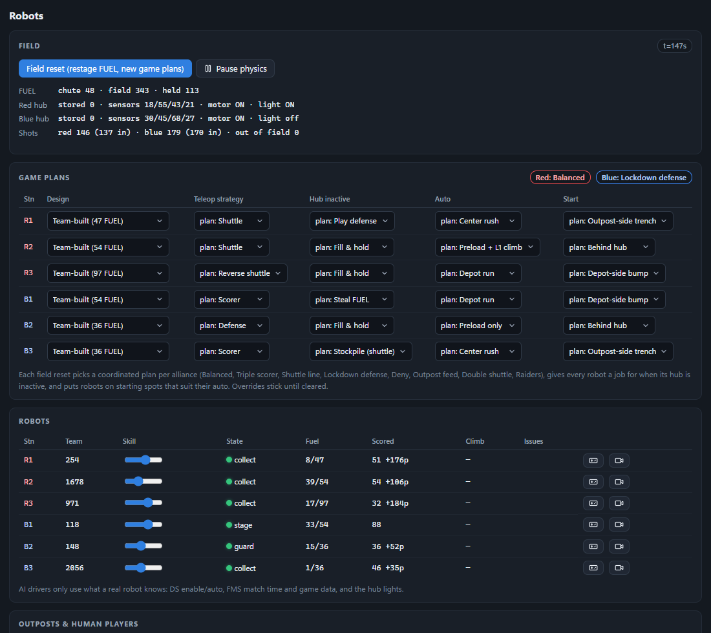

# User guide

This guide covers the simulator's window: the top bar, the 3D venue, every panel, driving a robot, and the event
director. To install and run your first match, see [GETTING_STARTED.md](GETTING_STARTED.md). For automated testing,
see [TESTING.md](TESTING.md).

## The main window

The **top bar** is always visible. It shows:

- the sim and arena links
- the current match, period, clock and hub shift
- both scores
- whether the field is ready to start. Hover over it to see what the arena is waiting for

Its buttons are **Load test**, **Start**, **Abort**, **Commit**, and **Report**, which asks what went wrong and saves a
bug-report bundle ([RECORDINGS.md](RECORDINGS.md#bug-report-bundles)).

If the sim loses the arena, or the arena can't start, a banner under the top bar says what is wrong and what is being
done about it. When there is something for you to do, such as choosing the arena folder, the banner has a button that
takes you there.

### The 3D venue

The 3D view shows the whole venue. Orbit with the mouse, pick a preset camera, or follow a robot. The field devices react
live:

- the hub LEDs come from the arena's real sACN packets
- the stack lights, hub motors and E-stop lights come from the PLC coils
- the arena's displays (audience, field monitor, timers, team signs) appear on screens around the venue

You can click the E-stop and A-stop buttons on the field to press them.

- **Graphics** (top right; the button shows the current preset, such as **High**). Quality presets (Low, Medium, High, picked automatically for your GPU the first
  time), tone mapping, exposure, and the field model.
- **Field model.** The sim's built field, or FIRST's official field CAD if you have imported it
  ([FIELD_MODEL.md](FIELD_MODEL.md)). The live parts (hub LEDs, chute doors, signs, buttons, screens) are the same
  either way.
- **People.** Referees, drive teams, human players, the field crew, the FTA and the crowd are rigged, animated people.
  The FTA stands at the scoring table end, works the field between matches, and gives the head referee a thumbs up when
  the arena reports the field ready.
- **Winner lights.** When the score is shown, the PLC's winner light show waits for the audience display's winner video
  to reveal the result, then plays on the venue lights in the winner's colors (Freezy Arena).
- **Broadcast cameras.** **Auto broadcast** is a camera director that works like a broadcast crew. Before a match it
  shows the venue and introduces each alliance. During the match it cuts between shooting runs, volleys, robots
  battling for position, defense, PIN counts, foul calls, human-player throws and end-game climbs, and follows an
  alliance on a scoring run. It shares the airtime between the robots, and its wide shots are framed to fit every
  robot. Afterwards it shows the final score. It picks angles that can see the action, tracks along rails and
  reframes. A caption at the bottom says what you are watching. **Broadcast** lays the arena's own audience display
  over the picture, as a stream would show it. **Audience** is the view from high in the stands.

  
  

How the robots, FUEL and officials behave is explained in [SIMULATION.md](SIMULATION.md).

### Viewer mode

**Viewer mode** shows the match the way a spectator sees it, without the engineering. Press **Viewer** in the top
bar, or open the sim's address with `?view=viewer` on the end (for example `http://127.0.0.1:8090/?view=viewer`).
That link is the one to give spectators on other devices once [remote access](CONFIGURATION.md#remote-access) is on.

In viewer mode:

- The panels, logs, top bar and 3D tool buttons are hidden. The 3D view fills the window on the **Auto broadcast**
  camera, with its LIVE caption.
- **The arena's own overlay** is keyed over the picture: the arena's real audience display, loaded with a transparent
  background. It is exactly what the arena shows on its audience screen (score bar, timer, match intro, final
  score), and it follows any change you make to the arena. What it shows is up to the arena, as at an event. After a
  match the arena can keep its full-screen final score up even once the next match is loaded; change it on the
  arena's Audience Display controls.
- **Simple** swaps the arena's overlay for the sim's own score bug (team numbers, scores, period, clock and hub
  shift), with an "Up next" card before a match and the result after it. Use it with an arena that has no audience
  overlay, or one left blank. The sim remembers your choice.
- Move the mouse and a control strip appears. Use it to pick a camera (**Auto**, **Wide**, **Overhead**, **Blue
  end**, **Red end**), switch the overlay, go **Full screen** (or press **F**), or **Exit viewer** (or press
  **Esc**). After 3 s without mouse movement, the strip and the mouse pointer hide.
- If the simulator or the arena drops out, a short line under the score says so, instead of a frozen score.

Viewer mode doesn't change the match; the arena keeps running it from the main window or the director.

### Panels

Panels dock beside the 3D view, in four groups: **Match** (Match, Match Log, Officials, Replay), **Field** (Driver
Stations, Robots, Field I/O, Network, Displays), **Simulation** (AI, Chaos) and **System** (Arena, Inspector, Log).
Pick a group, then a panel; each group remembers the panel you last used, and a dot on a group means one of its
panels has a count to look at (start blockers, problems, fouls or faults). Any panel can also pop out into its own window (the arrow at its top right). The sim remembers
where you put each window.

| Panel | Use it to |
|---|---|
| **Match** | Load and run matches, watch the arena's start blockers, run the [event director](#the-event-director), and see the **score check**: after every match, the arena's score is compared with what really happened on the field |
| **Driver Stations** | See and break each of the 6 driver stations: power, radio, roboRIO, code, Ethernet, battery, packet loss and latency, legacy protocol, team override. Pop out a mock DS screen with its diagnostics tab |
| **Robots** | Robot pose, hopper, AI state and faults. Take control of a robot ([below](#driving-a-robot)) |
| **AI** | Robot designs, strategies, auto routines, team learning, match seeds (to replay a match's exact AI decisions), offline pre-season training, and toggles such as "Robots can tip over" |
| **Field I/O** | Every PLC input, register and coil; the E-stop boxes; the PLC watchdog |
| **Officials** | The AI head referee (fouls, cards, field signals) and the AI FTA (connection checklist, help for teams, auto-bypass) |
| **Chaos** | Fault injection. Pick a level for random faults (Off, Occasional, Frequent or Mayhem: about 1.5, 3.5 or 7 problems a match), or inject one now: brownouts, radio reboots, code crashes, jams, tipping, E-stops, fouls. Each fault is followed by a **recovery check** that the arena handled it. With any level but Off there is also pre-match friction: teams late from queueing, no-shows, robots left switched off, E-stops left latched |
| **Network** | The live field network: AP SSIDs and keys, switch VLANs, SCC state, and RF quality by robot position. Turn network security on or off, take a device offline, or add RF interference |
| **Displays** | Open any arena display in its own window, or a display wall |
| **Inspector** | A packet log for every protocol, with filters and timing |
| **Replay** | Play back match recordings and saved black boxes in 3D ([RECORDINGS.md](RECORDINGS.md)) |
| **Match Log** | The auto-referee's settings and live log (with buttons to call a foul by hand), plus every saved match report |
| **Arena** | The sandbox launcher (build, start, stop, restart, reset the database, choose or change the arena folder), the arena's log, the "configure arena for sim" settings, port problems, and remote access |
| **Log** | The sim's own event log |

Every driver station has its own card in the **Driver Stations** panel, with the robot behind it. The 🖥 button on a
card opens a mock Driver Station screen for that team, showing what its drivers would see:

The **Chaos** panel injects faults and lists each recovery check:

## Driving a robot

In the **Robots** panel, take control of any robot. The AI hands it over, and the robot stays in the match as normal:
the arena still enables and disables it, and its FUEL still scores.

| | Keyboard | Gamepad (Xbox-style) |
|---|---|---|
| Drive | W A S D, or the arrow keys | Left stick |
| Turn | Q / E | Right stick, left and right |
| Intake | Shift | Left trigger |
| Shoot | Space | Right trigger |
| Climb | C | A |
| Hand back to the AI | Esc | — |

Motion is relative to the camera: from a driver station view, "up" drives away from that wall, as it does for a real
driver. A gamepad shows up after you press one of its buttons with the window focused.

## The event director

The event director does a scorekeeper's and a field crew's job. Find it in the **Match** panel, or run it headless with
`-director <type>` ([CLI.md](CLI.md)). For each match it:

1. loads the next match
2. waits for the robots to be carted on and the field to come ready
3. starts the match, and lets the AI play and the referees score it
4. checks the arena's score against the field
5. commits

It reports cycle time, time to field-ready, start delays and anomalies, and writes `run/reports/event-<type>-<time>.html`.

| Type | Runs |
|---|---|
| `qualification` / `practice` | The unplayed matches of that schedule, in order |
| `selection` | Scouting plus alliance selection (needs qualification results) |
| `playoff` | The playoff bracket, as it unfolds |
| `event` | The remaining quals, then selection, then the playoffs, and then it names the winner |

The arena needs a schedule for quals and practice. Create one in the arena's own setup pages, as you would for an
event, using the teams the sim added to it.

### Scouting

The sim scouts the event from two sources: the referees' per-robot match reports, and the arena's committed alliance
scores. The scouts are human, so their FUEL counts are slightly noisy. It writes two files:

- `scouting-<time>.csv`: one row per robot per match, like a scouting app export
- `picklist-<time>.csv`: per-team OPR, auto OPR and tower OPR (least squares over the alliance scores), average FUEL,
  climb points, reliability, and a combined pick value

### Alliance selection

Selection runs on the arena's own selection page, one step every few seconds, with the audience display set to
alliance selection so the venue screens show it.

- Each captain picks from its own slightly different view of the pick list. A captain values climbers more once its
  alliance can already score.
- A team that would otherwise become a captain may decline a lower seed's invitation. The arena then refuses that team
  as a pick, and it becomes a captain later.
- The sim follows the event's round 2 and round 3 order settings.
- If there are fewer ranked teams than the alliances need, the sim lowers the number of alliances (minimum 4), as a
  small event would.

### Playoffs

The bracket is read again after every match, because the arena fills in later matches as results come in. Before a
match, an alliance that hasn't used its timeout may call it. The arena runs the timeout, and the next match is loaded
during it, as a real scorekeeper would do. When the last match is decided, the director names the winning alliance.

Expect it to take real time. A qualification match cycle is about 5–7 minutes, and a full double elimination for 4–8
alliances has 10–16 matches.
